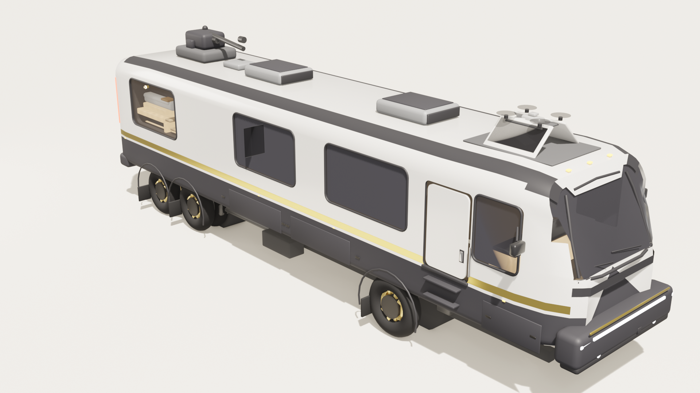

# 星泊豪华大巴房车 · StarPark Luxury Bus RV

**D 系列豪华大巴房车** —— 全程序化建模（Blender / bpy），可在浏览器中围绕外观环视，也可以进入车内驾驶舱、会客厅、厨卫、卧室与下层跑车库，前后左右自由观看。

在线访问（GitHub Pages）：**https://wangxp7.github.io/StarParkLuxuryBusRV-ZG5F/**



## 使用方式

| 视角 | 说明 |
|---|---|
| 外观环视 | 360° 围绕车身旋转观看（默认自动旋转） |
| 驾驶舱 | 进入前部驾驶舱，环视仪表台与 cream 座椅 |
| 会客厅 | 中部 L 形沙发会客区与大理石圆桌 |
| 厨卫 | 胡桃木厨房、大理石台面与卫浴 |
| 卧室 | 尾部上层升降卧铺（低顶抬高卧室） |
| 车库·跑车 | 下层跑车库内的樱桃红双座跑车 |

操作：**拖动**旋转（车内可前后左右环绕）· **滚轮/双指**缩放 · **右键拖动**平移 · 右下角可开关自动旋转与全屏。

## 技术说明

- 模型：Blender 4.x/5.x `bpy` 全程序化生成，导出为 glTF（GLB, 1.9 MB），Three.js r160 实时渲染
- 材质：44 种程序化 PBR 材质简化适配 glTF（深色玻璃使用 alpha 混合透出暖光内饰）
- 结构完整：车身壳体、梯形底盘车架、后置发动机（缸体/涡轮/水箱/变速箱）、三轴六轮、驾驶舱、L 形会客区、厨卫、上层升降卧铺、下层跑车库（樱桃红跑车）

## 文件

```
index.html                     网页查看器（Three.js）
model/StarParkLuxuryBusRV.glb  模型 (glTF Binary)
preview.jpg                    效果预览图
```

## 本地运行

```bash
# 任选一种静态服务器
python -m http.server 8080
# 或
npx serve .
```

浏览器打开 http://localhost:8080 即可。

---
建模 / 渲染：Blender + bpy · 网页：Three.js
